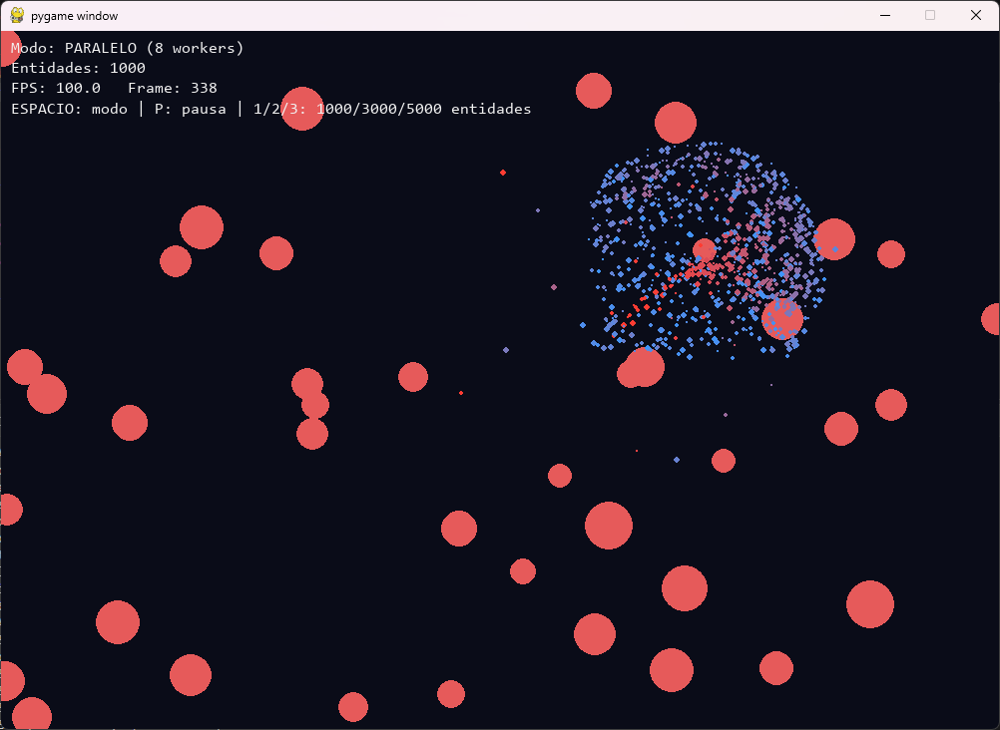
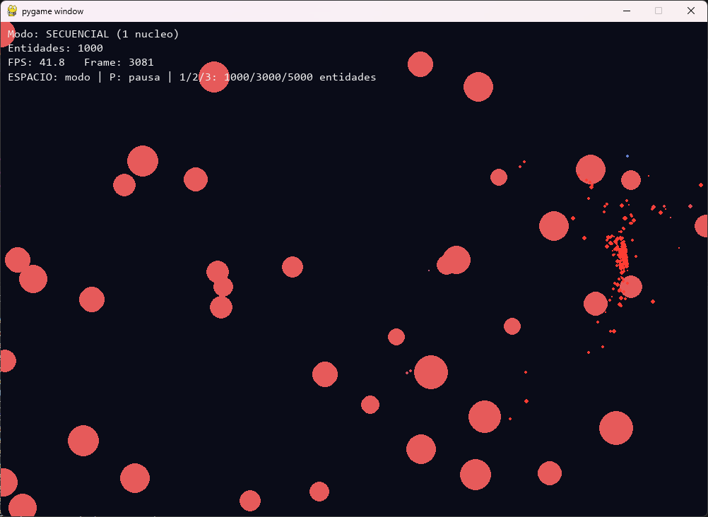

# Simulador de Enjambre / Asteroides

Simulador interactivo 2D de un enjambre de miles de entidades que son atraídas por el mouse
y repelidas por obstáculos. El cálculo de la física se reparte entre los núcleos de la CPU
con `multiprocessing`, y todo el código sigue las reglas de programación funcional:
estado único inmutable, funciones puras y transformaciones declarativas.

Proyecto de **Programación Funcional**. Integrantes:

- Elkin Eugenio
- Maite Guale
- Andy Ruiz

## Cómo ejecutarlo

Requiere Python 3.x.

```
pip install -r requirements.txt
python main.py        # simulador interactivo
python benchmark.py   # tablas de rendimiento (sin dibujar)
python -m pytest      # tests (pip install pytest)
```

> Si `pip install pygame` falla porque tu versión de Python es muy nueva (por ejemplo 3.15),
> instala `pygame-ce`, que se usa igual con `import pygame`.

### Controles

| Tecla | Acción |
|---|---|
| Mouse | Las entidades son atraídas hacia el cursor |
| `ESPACIO` | Cambia entre modo SECUENCIAL y PARALELO |
| `P` | Pausa / reanuda |
| `1` / `2` / `3` | 1,000 / 3,000 / 5,000 entidades |

## Arquitectura

| Archivo | Responsabilidad |
|---|---|
| `state.py` | `Entity`, `Obstacle`, `Events` y `GameState`, todos `@dataclass(frozen=True)` |
| `update.py` | Funciones puras de actualización (`step_entity`, `update_chunk`, `update_sequential`) |
| `parallel.py` | Segmentación, mapeo paralelo (`Pool.map`) y consolidación |
| `render.py` | Dibujo con Pygame (única capa con efectos secundarios) |
| `main.py` | Game loop: eventos → `update` → render |
| `benchmark.py` | Mide FPS secuencial vs paralelo y según número de workers |
| `tests/` | Tests de pureza y de equivalencia paralelo vs secuencial |

### Reglas de programación funcional

1. **Estado único inmutable:** todo el juego vive en `GameState` (`frozen=True`), sin variables globales mutables.
2. **Funciones puras:** `update(state, events, dt) -> GameState` devuelve un estado nuevo sin mutar el original. Las entidades también están congeladas.
3. **Sin `self` mutable:** no hay métodos que cambien atributos; los cambios se hacen con `dataclasses.replace`.
4. **Transformaciones declarativas:** se usan comprensiones, generadores y `map` en lugar de bucles que modifican datos.

## Evidencia de rendimiento

Tabla comparativa secuencial (1 núcleo) vs paralelo (N núcleos), medida con `python benchmark.py`.

### PC de Elkin

- Procesador: AMD Ryzen 7 5825U
- Núcleos detectados (lógicos): 16 | Workers configurados: 16
- Estrategia de partición: 16 segmentos contiguos de tamaño ~N/16

| Cantidad de entidades | Secuencial (1 núcleo) | Paralelo (16 núcleos) |
|---|---|---|
| 1,000 entidades | 18.0 FPS | 74.8 FPS |
| 3,000 entidades | 6.3 FPS | 26.8 FPS |
| 5,000 entidades | 3.9 FPS | 20.4 FPS |

### PC de Andy

- Núcleos detectados (lógicos): 8 | Workers configurados: 8
- Estrategia de partición: 8 segmentos contiguos de tamaño ~N/8
- Detalle completo en [`resultados/resultados_andy.md`](resultados/resultados_andy.md)

| Cantidad de entidades | Secuencial (1 núcleo) | Paralelo (8 núcleos) |
|---|---|---|
| 1,000 entidades | 49.2 FPS | 112.9 FPS |
| 3,000 entidades | 17.4 FPS | 72.1 FPS |
| 5,000 entidades | 10.5 FPS | 43.5 FPS |

### PC de Maite

- Núcleos detectados (lógicos): 12 | Workers configurados: 12
- Estrategia de partición: 12 segmentos contiguos de tamaño ~N/12

| Cantidad de entidades | Secuencial (1 núcleo) | Paralelo (12 núcleos) |
|---|---|---|
| 1,000 entidades | 24.8 FPS | 62.4 FPS |
| 3,000 entidades | 11.7 FPS | 22.4 FPS |
| 5,000 entidades | 7.4 FPS | 18.2 FPS |

En las tres máquinas el paralelo supera al secuencial en todas las cargas. La mejora no es
proporcional al número de núcleos porque enviar las entidades a los procesos (pickle) tiene un
costo que no se paraleliza, como se explica a continuación.

## Capturas




## Estrategia de partición

En cada frame, `update_parallel` (en `parallel.py`) hace tres pasos:

1. **Segmentación.** `split(state.entities, n_workers)` parte la tupla de entidades en
   segmentos **contiguos** de tamaño `ceil(N / workers)`. Con 5,000 entidades y 16 workers
   salen 16 segmentos de 313 entidades (el último un poco más corto). Se usa partición
   contigua porque cada entidad se calcula de forma independiente (no depende de las demás),
   así que el reparto es parejo y se conserva el orden original.
2. **Mapeo paralelo.** Cada segmento viaja a un proceso hijo junto con los datos de solo
   lectura (`dt`, tamaño del mundo, objetivo y obstáculos). `pool.map(update_chunk, tasks)`
   ejecuta la función pura `update_chunk` en cada worker y **bloquea hasta que todos terminan**,
   que es la sincronización del pipeline.
3. **Consolidación.** Los resultados se aplanan en una nueva tupla
   (`tuple(chain.from_iterable(results))`) y se construye un `GameState` nuevo con
   `dataclasses.replace`. El estado anterior nunca se modifica.

### ¿Por qué el `Pool` se crea una sola vez?

Crear procesos es caro (en Windows se usa *spawn*, que arranca un intérprete de Python nuevo
por proceso). Si se creara un `Pool` en cada frame, el costo de arrancar procesos sería mayor
que el cálculo. Por eso `main.py` y `benchmark.py` crean el `Pool` una sola vez y lo reutilizan.

### Costo de serialización (pickle)

Los procesos no comparten memoria: cada segmento de entidades se **serializa** (pickle) para
enviarlo al worker y los resultados se serializan de vuelta. Ese costo crece con el número de
entidades pero **no se paraleliza**, y por eso la mejora no es de `N` veces con `N` núcleos.
Con pocas entidades el costo de comunicación pesa más; con más entidades hay más cálculo por
byte enviado y la mejora relativa crece.

### ¿Por qué `mp.cpu_count()` cuenta más núcleos de los físicos?

`cpu_count()` devuelve procesadores lógicos (hilos). Una CPU de 8 núcleos con
hyperthreading reporta 16.